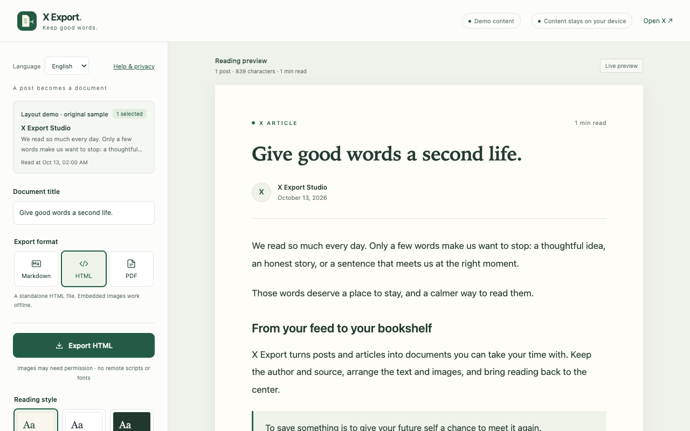
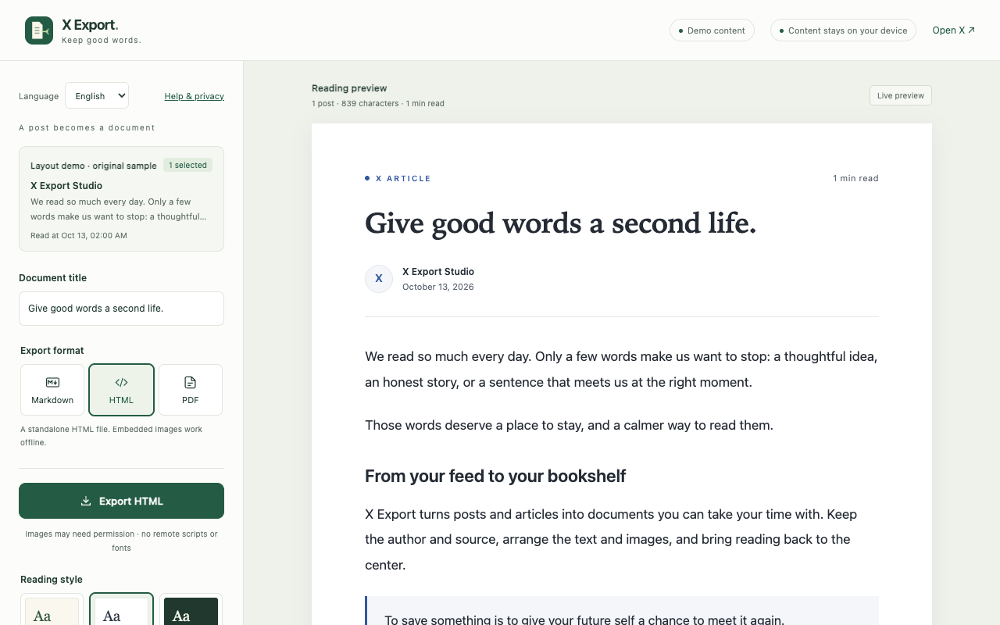
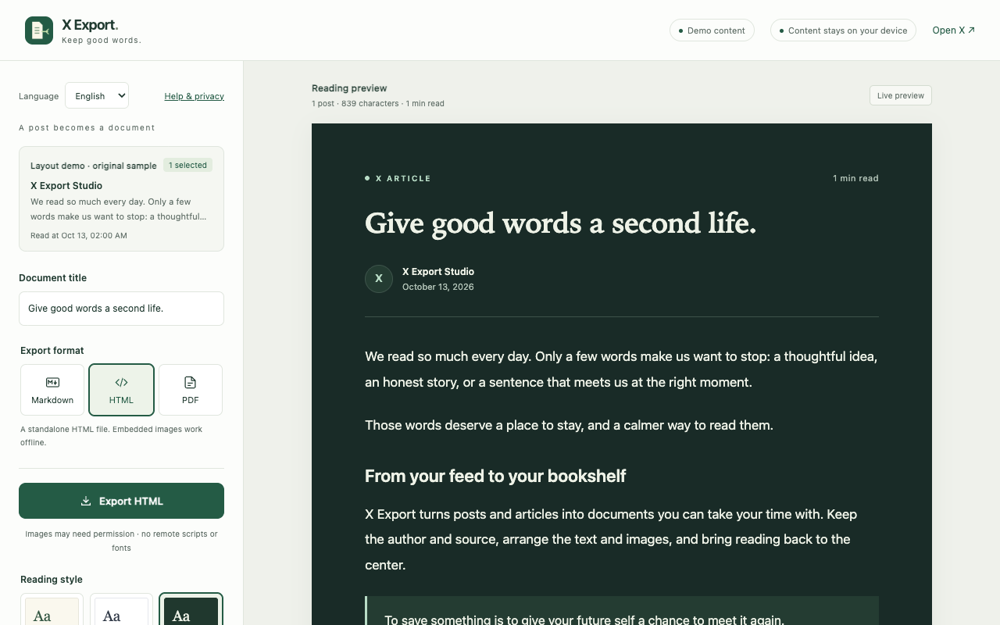
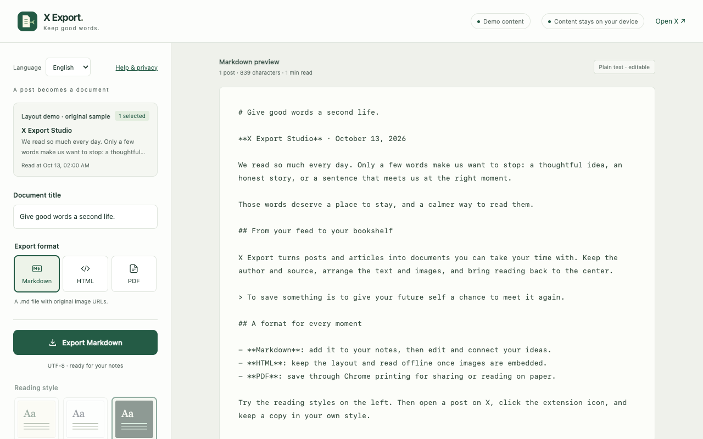

<div align="center">


<h1>X Export</h1>
<p><strong>Keep good words.</strong></p>
<p>Save X posts and articles as editable Markdown, styled HTML, or PDF through Chrome printing.</p>

<p>
  <a href="store/RELEASE-NOTES.md"></a>
  
  
  
  <a href="https://chromewebstore.google.com/detail/ndhnmjaofmpjpeminbnmgachmmdebeag"></a>
</p>

<p>
  <a href="https://chromewebstore.google.com/detail/ndhnmjaofmpjpeminbnmgachmmdebeag"><strong>Chrome Web Store · In review</strong></a>
  · <a href="#quick-start">Quick start</a>
  · <a href="#preview">Preview</a>
  · <a href="https://leondevlifelog.github.io/x-export/">Website</a>
  · <a href="README.md">简体中文</a>
</p>

</div>

> **v1.1.0 · Chrome Web Store review is pending.** You can try the extension by loading it from source while the listing is under review.

## Why X Export

Turn something worth keeping from your feed into a document you can revisit, edit and share.

- **Keep the content and its attribution**: text, authors, dates, links, images and quotes; articles retain headings, lists and code.
- **Choose your reading style**: Paper, Minimal or Night, three font sizes, and controls for images, quotes and source links.
- **Review your selection**: the current post is selected by default; add other already-loaded posts by the same author after reviewing them.
- **Use your existing X session**: works with the account signed in to Chrome, with local processing and no extra account or developer API key.
- **English and Simplified Chinese**: follow Chrome or switch manually. Original text, attribution and edited titles stay unchanged.

## Preview

**Paper · Export studio**

[](store/assets/en/01-paper.png)

<details>
<summary><strong>View Minimal, Night and Markdown previews</strong></summary>

### Minimal



### Night



### Markdown



</details>

<sub>These are actual extension screenshots using the project's original demo content. Click the studio screenshot to view it at full size.</sub>

## Export formats

| Format | Best for | Images and reading |
| --- | --- | --- |
| **Markdown** | Notes, further editing, knowledge archives | UTF-8 text with original image URLs; images need a network connection |
| **HTML** | A complete, styled reading copy | Standalone file with bundled styles; successfully embedded images work offline |
| **PDF** | Page-based reading, printing, sharing | Save through Chrome printing with automatic A4 pagination |

Embedding images in HTML/PDF requests optional access to X's image CDN. Denied permission or failed images leave text, a clear fallback notice and original-image links. Night prints in light colors.

## Quick start

**Requires Chrome 114+ and an X account signed in to this browser.** Try demo lets you explore the layout without signing in.

### 1. Install from source

Building requires Git, Node.js 20+, and system `zip` / `unzip` commands.

```sh
git clone https://github.com/LeonDevLifeLog/x-export.git
cd x-export
npm ci
npm run build
```

1. Open `chrome://extensions` and enable **Developer mode**.
2. Choose **Load unpacked** and select the generated **`dist/x-export`** directory.
3. Pin **X Export** to your toolbar.

The build also produces `dist/x-export-v1.1.0.zip`. If installing from a ZIP, unzip it first and select the directory containing `manifest.json`.

### 2. Save your first post

1. **Open the source**: open a post detail or complete article on X. Expand Show more and wait for the text to load.
2. **Read and preview**: click the extension → **Read current post**. Review content, edit the title, and choose a format and style.
3. **Export**: save Markdown or HTML. For PDF, complete the save in Chrome's print dialog.

> For PDF, choose Save as PDF, disable headers and footers, and enable background graphics if wanted.

**About** in the popup opens the developer introduction, [GitHub profile](https://github.com/LeonDevLifeLog) and [project repository](https://github.com/LeonDevLifeLog/x-export).

## Content boundaries

- Supports `x.com` / `twitter.com`, including `www` / `mobile` domains. A detail page makes the export target explicit.
- Reads only already-loaded content visible to your account. No automatic scrolling, unloaded-thread retrieval, or bypass of login, subscriptions or access controls.
- Other loaded posts by the same author can be unrelated. Review them individually; they are not automatically treated as a complete thread.
- Folded text blocks export. Expand it on X and read the page again.
- Videos retain source-view links. Quoted posts retain text and attribution; quoted images are not downloaded separately.
- X can change its page structure. Report extraction issues with a public example through [GitHub Issues](https://github.com/LeonDevLifeLog/x-export/issues).

## Privacy and permissions

No developer backend, ads, analytics or remote executable code. The extension does not read passwords, cookies or access tokens. Documents use temporary browser session storage; layout and language preferences stay on your device.

| Permission | When it is used |
| --- | --- |
| `activeTab` + `scripting` | Temporarily read the current X page after you click the extension |
| `storage` | Keep temporary previews and local preferences |
| `downloads` | Save Markdown or HTML that you request |
| `https://pbs.twimg.com/*` **optional** | Fetch X CDN images when you choose HTML/PDF embedding |

Markdown never requests image permission. Previewing and embedding images can contact X's CDN; local processing does not mean zero network requests.

<details>
<summary>Retention, deletion and image handling</summary>

- Documents use `chrome.storage.session`, cleared when Chrome closes. Records older than 24 hours are removed on the next capture, not by scheduled deletion.
- Layout and language use `chrome.storage.local`, without Chrome Sync.
- **Help & privacy → Clear temporary documents** removes session documents and invalidates open previews. Manage downloaded files separately.
- Page data is structured and HTML-escaped; original page HTML, scripts and event handlers are not copied.
- Embedding accepts X CDN PNG / JPEG / WebP / GIF only, using anonymous HTTPS without referrers or redirects.
- Limits: 8 MiB per image, 32 MiB total, three concurrent fetches, and a 12-second timeout per request.
- Exported files may contain non-public content visible to your X account. Sharing is your choice.

</details>

[Full privacy policy](https://leondevlifelog.github.io/x-export/privacy.html) · [Help and support](https://leondevlifelog.github.io/x-export/support.html)

## Development and verification

Native JavaScript / CSS and Chrome Manifest V3, with **no production dependencies or bundler**.

<details>
<summary><strong>Development commands, structure and verification</strong></summary>

### Local development

After `npm ci`, run:

```sh
npm run check
npm test
npx playwright install chromium
npm run test:browser
```

Browser scripts use isolated profiles. Set `PLAYWRIGHT_CHROMIUM_EXECUTABLE` to an existing Chromium / Chrome for Testing executable if needed; personal Chrome profiles are not used.

```sh
npm run dev
# Open http://127.0.0.1:4173/preview.html?demo=1
```

This page previews the layout. Real X extraction requires loading the extension. After editing runtime code, run `npm run build` and reload the extension.

### Structure

```text
extension/       Runtime, locale resources and bundled privacy policy
  lib/           X DOM extraction, document rendering, images and downloads
  document.css   Reading layout and A4 print styles
store/           Listing copy, actual screenshots and public website
scripts/         Build, checks, previews and submission packaging
tests/           Export boundaries and isolated browser scenarios
docs/            MVP release baseline
artifacts/       Local verification output; excluded from the extension
```

The extractor supports traditional `data-testid` and semantic `article` layouts. Preview, HTML and PDF share a renderer. Detail pages match the post ID in the URL; feeds use the first loaded post in the viewport. The toolbar name follows Chrome's UI language, independently of the extension's manual language choice.

Local automation, native toolbar/dialog flows, and real-page DOM checks are recorded separately. Test counts do not establish complete live acceptance; see [VERIFICATION.md](VERIFICATION.md) for evidence and scope.

### Submission materials

```sh
npm run build
npm run store:assets
npm run store:check
npm run store:bundle
```

Upload only `dist/x-export-v1.1.0.zip` as the extension. `dist/x-export-webstore-v1.1.0.zip` is the complete handoff archive containing localized copy, permission/data disclosures, reviewer instructions, screenshots and promotional artwork.

[Submission guide](store/SUBMISSION.md) · [Release notes](store/RELEASE-NOTES.md) · [MVP baseline](docs/MVP.md)

GitHub Pages deploys `store/site` automatically when that directory or the Pages workflow changes on `main`. Hosted and bundled policy text remains consistent.

</details>

---

Developed and maintained by [LeonDevLifeLog](https://github.com/LeonDevLifeLog). Feedback is welcome through [Issues](https://github.com/LeonDevLifeLog/x-export/issues).

X Export is independent and is not affiliated with X Corp.
