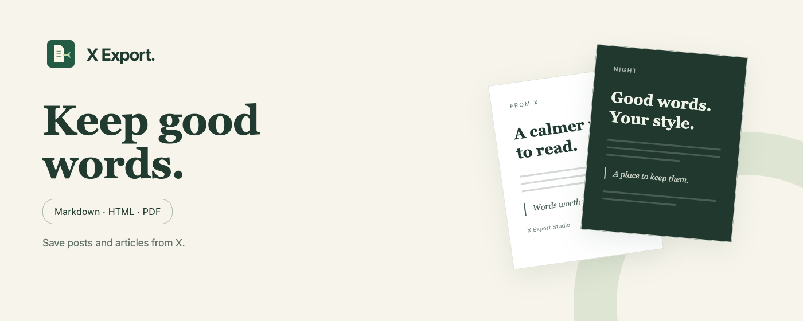
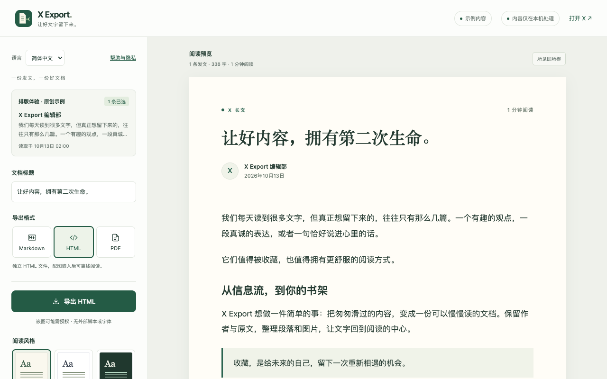
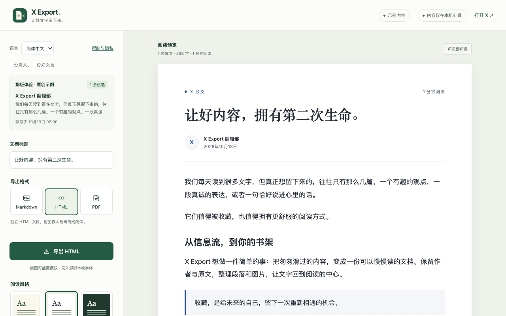
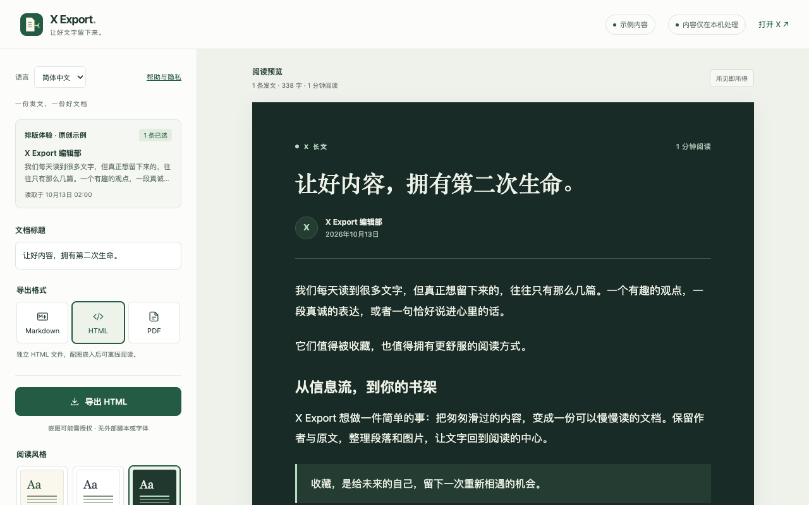
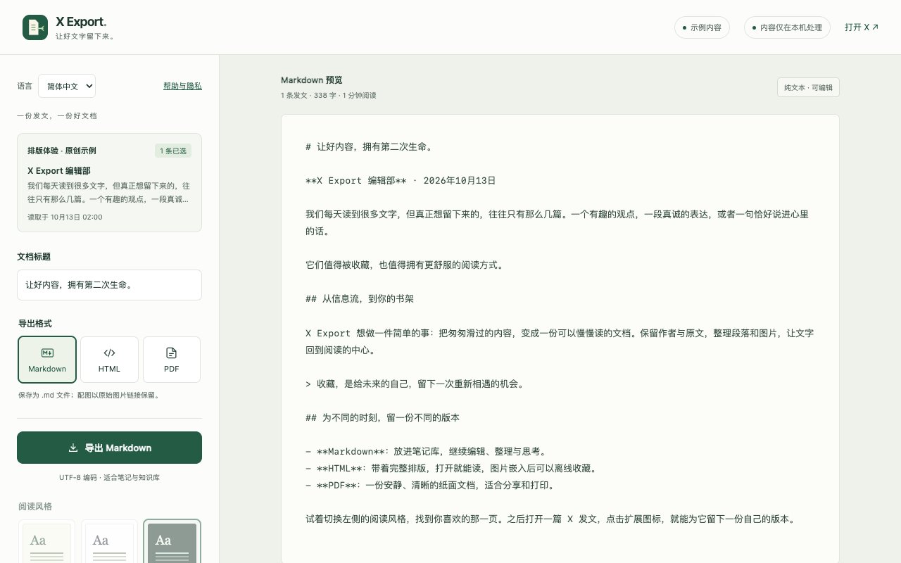

<div align="center">



<h1>X Export</h1>
<p><strong>让好文字留下来。</strong></p>
<p>将 X（Twitter）帖子与长文，保存为可编辑的 Markdown、精美 HTML，或通过 Chrome 打印保存 PDF。</p>

<p>
  <a href="store/RELEASE-NOTES.md"></a>
  
  
  
  <a href="https://chromewebstore.google.com/detail/ndhnmjaofmpjpeminbnmgachmmdebeag"></a>
</p>

<p>
  <a href="https://chromewebstore.google.com/detail/ndhnmjaofmpjpeminbnmgachmmdebeag"><strong>查看 Chrome 商店 · 审核中</strong></a>
  · <a href="#快速开始">快速开始</a>
  · <a href="#界面预览">界面预览</a>
  · <a href="https://leondevlifelog.github.io/x-export/">项目官网</a>
  · <a href="README.en.md">English</a>
</p>

</div>

> **当前版本 v1.1.0 · Chrome Web Store 审核中。** 审核通过前，可通过下方源码安装方式体验。

## 为什么用 X Export

把信息流里值得保留的内容，整理成一份适合收藏、重读和分享的文档。

- **保留内容与归属**：正文、作者、日期、链接、图片和引用；长文支持标题、列表与代码。
- **排版随你选择**：纸感杂志、纯净白、夜读三种风格，三档字号，可选择配图、引用与原文链接。
- **选择要留存的发文**：默认只导出当前发文；同作者的其他已加载内容可逐条核对后选入。
- **复用当前登录态**：使用浏览器中已登录的 X 账号，内容在本机处理，无需另一个账号或开发者 API Key。
- **中英文界面**：自动跟随 Chrome，也可手动切换；原文、作者和你修改的标题保持原样。

## 界面预览

**纸感杂志 · 导出工作台**

[](store/assets/zh_CN/01-paper.png)

<details>
<summary><strong>查看纯净白、夜读与 Markdown 预览</strong></summary>

### 纯净白



### 夜读



### Markdown



</details>

<sub>以上均为实际扩展界面，使用本项目原创示例内容。点击工作台截图可查看大图。</sub>

## 导出格式

| 格式 | 适合什么 | 图片与阅读方式 |
| --- | --- | --- |
| **Markdown** | 笔记整理、继续编辑、知识库归档 | UTF-8 文本，保留原图 URL；图片需要联网加载 |
| **HTML** | 保存一份排版完整的阅读副本 | 独立文件、内置样式；成功嵌入的图片可离线阅读 |
| **PDF** | 分页阅读、打印、分享 | 通过 Chrome 打印保存，A4 自动分页 |

HTML / PDF 嵌图时会按需申请 X 图片 CDN 权限。拒绝或图片读取失败时，仍保留文字、明确的失败说明与原图链接。夜读主题打印时自动转为浅色。

## 快速开始

**使用前提：Chrome 114+，且当前浏览器已登录 X。** 首次体验排版可点击“体验示例”，不需要登录。

### 1. 从源码安装

构建需要 Git、Node.js 20+，以及系统 `zip` / `unzip` 命令。

```sh
git clone https://github.com/LeonDevLifeLog/x-export.git
cd x-export
npm ci
npm run build
```

1. 打开 `chrome://extensions`，启用右上角的 **开发者模式**。
2. 点击 **加载已解压的扩展程序**，选择生成的 **`dist/x-export`** 文件夹。
3. 将 **X Export** 固定到工具栏。

构建同时生成 `dist/x-export-v1.1.0.zip`。如果使用 ZIP 安装，先解压，再选择包含 `manifest.json` 的目录。

### 2. 保存第一篇发文

1. **打开原文**：在已登录的 X 中打开帖子详情或完整长文，展开“显示更多”，等待正文加载。
2. **读取与预览**：点击扩展 → **读取当前发文**，核对内容、修改标题、选择格式和风格。
3. **导出文档**：保存 Markdown / HTML；选择 PDF 时，在 Chrome 打印窗口中保存。

> 保存 PDF 时，选择“保存为 PDF”，关闭“页眉和页脚”，按需开启“背景图形”。

弹窗底部的 **关于** 提供开发者介绍、[GitHub 主页](https://github.com/LeonDevLifeLog)与[项目仓库](https://github.com/LeonDevLifeLog/x-export)链接。

## 内容边界

- 支持 `x.com` / `twitter.com` 及其 `www` / `mobile` 域名。建议从详情页读取，以明确导出目标。
- 只读取当前页面已加载、当前账号可见的内容；不自动滚动、不补全未加载的串文，也不绕过登录、订阅或访问权限。
- 同作者已加载的帖子可能互不相关；需要逐条核对，不会自动认定为完整串文。
- 正文仍折叠时会阻止导出。请先在 X 展开，再重新读取。
- 视频保留原文查看链接；引用发文保留文字与来源，引用中的图片不单独下载。
- X 页面结构会变化。遇到读取异常，可通过 [GitHub Issues](https://github.com/LeonDevLifeLog/x-export/issues) 反馈公开样例。

## 隐私与权限

没有开发者后端、广告、统计埋点或远程可执行代码；不读取密码、Cookie 和访问令牌。预览文档暂存在浏览器会话中，排版与语言偏好保存在本机。

| 权限 | 何时使用 |
| --- | --- |
| `activeTab` + `scripting` | 你点击扩展后，临时读取当前 X 页面的已加载内容 |
| `storage` | 暂存预览文档，保存本机偏好 |
| `downloads` | 保存你主动导出的 Markdown / HTML |
| `https://pbs.twimg.com/*` **可选权限** | 你选择 HTML / PDF 嵌图时，读取 X 图片 CDN |

Markdown 不申请图片权限。预览及嵌图可能向 X CDN 请求图片；“本机处理”不等于完全不联网。

<details>
<summary>数据保留、清理与图片处理细节</summary>

- 文档使用 `chrome.storage.session`；关闭浏览器后清除。超过 24 小时的记录在下次读取时清理，并非定时删除。
- 排版和语言偏好使用 `chrome.storage.local`，不使用 Chrome Sync。
- **帮助与隐私 → 清除临时文档** 会清除会话文档并使其打开的预览失效；已下载文件需单独管理。
- 页面内容经结构化转换和 HTML 转义，不复制原页面脚本、事件处理器或 HTML。
- 图片嵌入只接受 X CDN 的 PNG / JPEG / WebP / GIF；匿名 HTTPS 读取、不携带 referrer、不跟随重定向。
- 单张图片上限 8 MiB，单次总预算 32 MiB，3 路并发，每次请求 12 秒超时。
- 导出文档可能包含当前 X 账号可见的非公开内容；是否分享由你决定。

</details>

[完整隐私政策](https://leondevlifelog.github.io/x-export/privacy.html) · [帮助与支持](https://leondevlifelog.github.io/x-export/support.html)

## 开发与验证

原生 JavaScript / CSS，Chrome Manifest V3，**无生产依赖、无需打包器**。

<details>
<summary><strong>展开开发命令、项目结构与验证说明</strong></summary>

### 本地开发

在已执行 `npm ci` 的项目目录中运行：

```sh
npm run check
npm test
npx playwright install chromium
npm run test:browser
```

浏览器脚本使用隔离 profile。可通过 `PLAYWRIGHT_CHROMIUM_EXECUTABLE` 指定已有 Chromium / Chrome for Testing，不使用个人 Chrome 资料。

```sh
npm run dev
# 访问 http://127.0.0.1:4173/preview.html?demo=1
```

该页面用于排版体验，真实 X 提取需要加载扩展。修改代码后重新执行 `npm run build`，再到扩展管理页点击“重新加载”。

### 项目结构

```text
extension/       运行代码、双语资源与随包隐私政策
  lib/           X DOM 提取、文档生成、嵌图与下载
  document.css   阅读与 A4 打印样式
store/           商店文案、实际界面截图与公开网站
scripts/         构建、检查、预览与材料打包
tests/           导出边界与隔离浏览器场景
docs/            MVP 发布基线
artifacts/       本地验证产物，不进入扩展包
```

提取器兼容传统 `data-testid` 与新版语义 `article` 页面结构；预览、HTML 与 PDF 使用同一套文档生成器。信息流中读取当前视口第一条已加载帖子，详情页优先匹配 URL 中的帖子 ID。工具栏名称跟随 Chrome 自身界面语言，插件内语言选择不会改变它。

本地自动化、原生工具栏/系统窗口、真实页面 DOM 核对的证据分别记录。测试数量不代表完整线上验收，具体范围见 [VERIFICATION.md](VERIFICATION.md)。

### 发布材料

```sh
npm run build
npm run store:assets
npm run store:check
npm run store:bundle
```

仅将 `dist/x-export-v1.1.0.zip` 上传为扩展包。`dist/x-export-webstore-v1.1.0.zip` 是完整材料移交包，包含双语文案、权限/数据声明、审核说明、截图与宣传图。

[商店提交指南](store/SUBMISSION.md) · [版本说明](store/RELEASE-NOTES.md) · [MVP 基线](docs/MVP.md)

GitHub Pages 发布 `store/site`；该目录或 Pages workflow 推送到 `main` 后自动部署。公开政策与扩展随包政策保持正文一致。

</details>

---

由 [LeonDevLifeLog](https://github.com/LeonDevLifeLog) 开发与维护。欢迎通过 [Issues](https://github.com/LeonDevLifeLog/x-export/issues) 反馈问题。

X Export 是独立工具，与 X Corp. 无关联。
